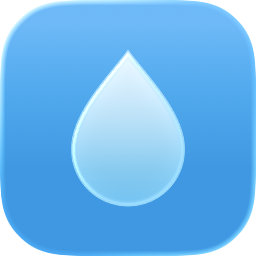

<div align="center">



# Rinse

**Copy anything. Paste plain text.**

Clears formatting from the text you copy, so it pastes in the style of the document you paste into.

[Download](https://github.com/gustaferiksson/rinse/releases/latest) · [Install with Homebrew](#install) · Requires macOS 26

</div>

## What it does

Copy a paragraph from a web page, an email or a PDF and Rinse rewrites the clipboard to plain text within a fraction of a second. Paste it anywhere and it takes on the fonts and colors of where it lands, without reaching for Paste and Match Style.

Rinse is a small, native menu bar app. It only touches rich text (RTF, HTML): file copies, password managers and anything marked concealed or transient are left alone.

| | |
|---|---|
| **Clear formatting** | Rewrites copied rich text to plain text. Hold ⌥ Option while copying to keep the formatting for that one copy. |
| **Text cleanup** | Optionally removes invisible characters, trims surrounding whitespace and normalizes curly quotes. |
| **Link cleanup** | Strips tracking parameters (`utm_*`, `fbclid`, `gclid` and friends) and `mailto:` or `tel:` prefixes when the copied text is a single link or address. |
| **Excluded apps** | Password managers and Excel are skipped by default. Add any app whose formatting you want to keep. |
| **Clipboard managers** | Marks its rewrite with `org.nspasteboard.source` so clipboard managers still see the original app. An Advanced option adds `org.nspasteboard.AutoGeneratedType` for apps that append to the clipboard, such as Alfred. |
| **Control Center** | A control to turn automatic clearing on or off. |
| **Menu bar** | An optional menu bar icon with the same toggle. Hide it in Settings; open Rinse again to get Settings back. |
| **Settings** | Launch at login, the cleanup options with a live Try It preview, excluded apps and updates. |
| **Updates** | Checks GitHub Releases at launch and installs new versions in place. |

## Install

```sh
brew install --cask gustaferiksson/tap/rinse
```

Or download `Rinse-<version>.zip` from the [latest release](https://github.com/gustaferiksson/rinse/releases/latest) and move `Rinse.app` to `/Applications`. Rinse is signed and notarized, and updates itself.

Quit any other clipboard cleaner first. Two apps rewriting the same clipboard will fight over it.

<details>
<summary><b>Building from source</b></summary>

<br>

You need Xcode and [XcodeGen](https://github.com/yonaskolb/XcodeGen) (`brew install xcodegen`).

```sh
./build.sh           # dist/Rinse.app, ad hoc signed unless .env sets a team
open dist/Rinse.app
```

Without `.env` the build is ad hoc signed. It runs, but the App Group (`<team>.dev.gustaf.rinse`) is team prefixed, so settings don't persist and the Control Center toggle can't reach the app. Copy `.env.example` to `.env` and set `DEVELOPMENT_TEAM` and `CODE_SIGN_IDENTITY` for a build where both work.

Run the tests with:

```sh
xcodebuild -project Rinse.xcodeproj -scheme Rinse -derivedDataPath .build test
```

The Xcode project is generated by XcodeGen and isn't tracked. Releases are tagged and built by GitHub Actions, see [docs/RELEASING.md](docs/RELEASING.md) and [SHIPPING.md](SHIPPING.md).

</details>

## License

[MIT](LICENSE).
